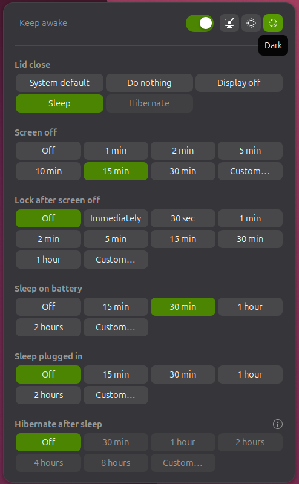
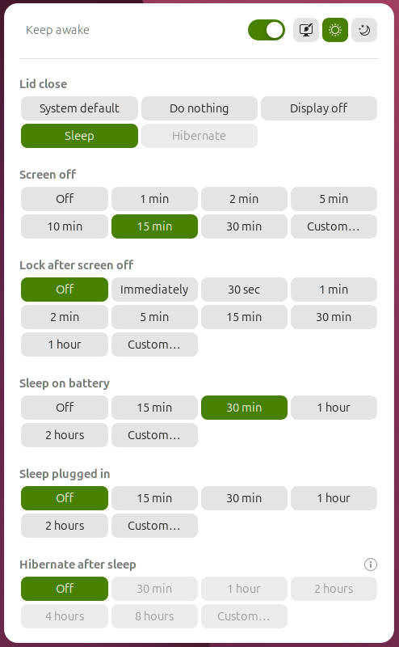

# Sandman

A GNOME Shell extension that puts keep awake, lid close, screen off, lock, sleep and hibernate in one top bar menu. It works with GNOME's own settings where they exist and adds what GNOME Settings does not offer, such as a lid close action and hibernate after sleep.

<p align="center">
  
  &nbsp;&nbsp;
  
</p>

## Controls

In popup order. Keep awake and Appearance share the top row.

- **Appearance**: System, Light or Dark, written to GNOME's `color-scheme` setting (System is GNOME's default, which most apps render as light).
- **Keep awake**: a switch. While on, Sandman holds a session inhibitor for idle and suspend.
- **Lid close**: laptops only. System default, Do nothing, Display off, Sleep or Hibernate.
- **Screen off**: how long until the screen turns off.
- **Lock after screen off**: how long after the screen turns off the session locks. The delay counts from screen off, as in GNOME Settings.
- **Sleep on battery**: suspend after this idle time on battery.
- **Sleep plugged in**: suspend after this idle time on AC power. Sleep is Sandman's own timer.
- **Hibernate after sleep**: how long a suspended computer waits before it hibernates.

Each timer offers presets, Off, and Custom hours and minutes.

Screen off and Lock write GNOME's own settings (`org.gnome.desktop.session idle-delay`, `org.gnome.desktop.screensaver lock-enabled` and `lock-delay`). Settings and Sandman always agree. With Screen off set to Off, GNOME never idles and lock cannot fire. Sandman shows a warning in that case.

## Install

```sh
./install.sh
```

Log out and back in (required on Wayland), then enable the extension:

```sh
gnome-extensions enable sandman@pmnelx.github.io
```

**Hibernate after sleep** changes systemd's system-wide hibernate delay, so
it needs a privileged helper and its polkit policy:

```sh
./install.sh --system
```

This installs `/usr/local/libexec/sandman-configure-hibernate` and the
`io.github.pmnelx.sandman.configure-hibernate` polkit action. Changing the
delay then asks for administrator authorization.

## How sleep and hibernate work

Sleep is Sandman's own idle timer. While the extension is enabled, GNOME's Automatic Suspend (`sleep-inactive-ac-type` and `sleep-inactive-battery-type`) is set to `nothing`. Sandman saves the previous values and restores them when you disable the extension. Disable the extension before uninstalling it, so GNOME's Automatic Suspend settings are restored.

On first enable, Sandman adopts your existing Automatic Suspend timeouts, but only where GNOME would have suspended. Enabling it changes nothing by itself. If you later turn Automatic Suspend on in Settings, Sandman adopts that value and takes over again. This also applies while the extension is disabled: if you change Automatic Suspend in Settings and it is on when you enable Sandman again, Sandman adopts that timeout.

Sleep respects application inhibitors:

- An idle inhibitor pauses the timer entirely.
- A suspend-only inhibitor postpones sleep until it is released.
- If the idle time already exceeds the timeout when the inhibitor is released, Sandman sleeps at once.

Sandman does not suspend while another user's session is active.

Hibernate after sleep uses systemd's `suspend-then-hibernate`. The delay is `HibernateDelaySec` in `/etc/systemd/sleep.conf.d/90-sandman.conf`. The root helper writes it through pkexec, so changing the delay asks for administrator authorization.

While a removable (Thunderbolt or USB4) GPU is attached, Sandman uses plain suspend instead. Such GPUs can fail to resume from hibernation.

## Lid close

For any action other than System default, Sandman holds a logind `handle-lid-switch` inhibitor and reacts to logind's lid state itself.

- **System default** leaves logind.conf in charge.
- **Display off** turns the built-in panel off when no external monitor is attached. With one attached, GNOME already does this.
- **Sleep** and **Hibernate** act even when docked, because you chose them explicitly. Use Do nothing or Display off for clamshell use.
- **Sleep** follows the same rule as the sleep timer: suspend then hibernate when Hibernate after sleep is set, but plain suspend while a removable GPU is attached.
- **Lid actions always run**, even while keep awake is on, because closing the lid is an explicit request. Under System default, logind also ignores session inhibitors on lid close.
- With System default selected, GNOME itself blocks lid-close suspend while an external monitor is attached.

## Hibernate prerequisites

Hibernate after sleep is available only when logind reports `CanSuspendThenHibernate` as yes. Otherwise the positive values are disabled and the menu shows why. The usual causes are:

- The kernel has no hibernation support, or `/sys/power/disk` is disabled.
- Kernel lockdown, which Secure Boot turns on.
- No disk-backed swap, or swap smaller than RAM.
- No resume device.

## Requirements

- GNOME Shell 48 to 51 on Wayland
- systemd
- UPower
- polkit, for hibernate after sleep

## Development

```sh
npm test
npm run pack
```

`npm test` runs node tests for the pure model and diagnostics, and Python tests for the helper. `npm run pack` builds the extension zip.

To try it in a nested shell:

```sh
dbus-run-session -- gnome-shell --devkit
```

Use `--nested` instead of `--devkit` on GNOME 48. Reloading extension code on Wayland needs a log out and in.

## Credits

Forked from [lgse/sandman](https://github.com/lgse/sandman) by Pierre Berube, an Omarchy Quattro plugin. The last Omarchy commit is tagged `omarchy-final`.

## License

MIT
